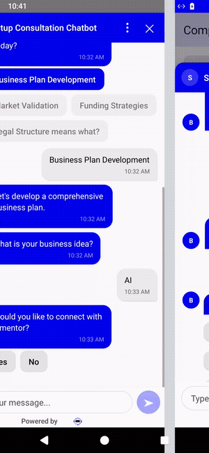
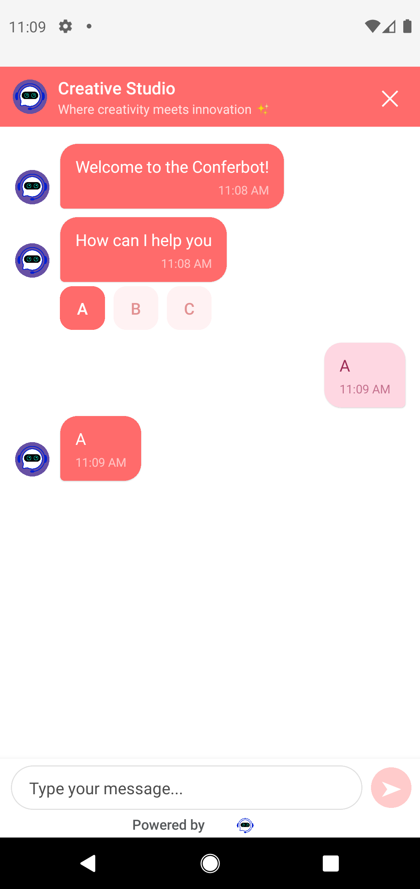

# Conferbot Android SDK

[](https://central.sonatype.com/artifact/com.conferbot/android-sdk)
[](https://developer.android.com)
[](https://kotlinlang.org)
[](LICENSE)

The official Android SDK for integrating [Conferbot](https://conferbot.com) into Kotlin and Java applications. Supports XML Views, Jetpack Compose, and headless (custom UI) patterns.

## See it in action

The complete flow recorded live on an Android emulator against production: open the floating widget, bot loads with server theming, welcome message with GIF, name captured through the input bar, choice selection with the transcript kept intact (selected chip stays highlighted, the rest disabled), and follow-up nodes.

<p align="center">
  
</p>

<p align="center"><a href="docs/demo.mp4">HD video (MP4)</a></p>

<p align="center">
  
  
  
</p>

## Features

- **Floating chat widget (FAB)** - the same bubble-in-the-corner experience as the Conferbot web widget, driven by your dashboard customizations
- **Drop-in chat UI** - full-screen Activity for XML apps, composables for Compose apps
- **Headless SDK** - every piece of state exposed as Kotlin `StateFlow` for fully custom UIs
- **Real-time messaging** - Socket.IO powered communication with the Conferbot flow engine
- **Server-driven theming** - colors, avatar, bot name, backgrounds, and widget placement configured in the dashboard apply automatically
- **Live agent handover** - transition to human agents with typing indicators, back-in-the-queue lines, a closed chat with "Start a new chat", "Email me this chat", help articles and games while the visitor waits, and "Your requests" to follow and answer their conversations with the team
- **Home screen** - when the owner turns it on, the chat opens on the web widget's home: a greeting, "Ask anything", "Talk to us" with the team's reply time, your requests, help articles and your customer logos
- **Offline support** - message queueing with automatic retry when connectivity returns
- **Session persistence** - chat history survives app restarts via Room
- **Message pagination** - efficient loading of large conversation histories
- **Push notifications** - FCM token registration, notification handling, and in-app banners
- **Knowledge base** - searchable help center screen with categories, articles, and ratings
- **File uploads** - image and file attachments with validation and progress
- **Analytics** - UTM attribution, interactions, goals, and CSAT/NPS ratings

## Requirements

| Requirement | Minimum |
|-------------|---------|
| Android     | 5.0 (API 21) |
| Kotlin      | 1.9 |
| Java        | 17 (SDK compiles with `jvmTarget 17`) |
| Compile SDK | 34 |

## Installation

Add the Maven Central repository (if not already present) and the SDK dependency. The published coordinates are `com.conferbot:android-sdk:1.0.0`.

**Settings or project-level `build.gradle`:**

```gradle
dependencyResolutionManagement {
    repositories {
        google()
        mavenCentral()
    }
}
```

**App-level `build.gradle`:**

```gradle
dependencies {
    implementation 'com.conferbot:android-sdk:1.0.0'
}
```

Or with Kotlin DSL:

```kotlin
dependencies {
    implementation("com.conferbot:android-sdk:1.0.0")
}
```

Sync your Gradle files after adding the dependency. To build against a local checkout instead, include the `:conferbot` module in your `settings.gradle`.

## Getting Your API Key and Bot ID

You need two credentials to use the SDK:

1. **Log in** to the [Conferbot Dashboard](https://app.conferbot.com)
2. **Create or select a bot** from the dashboard
3. **Find your Bot ID**: Go to **Bot Settings** > **General** - the Bot ID is displayed at the top
4. **API Key**: any placeholder works (e.g. `conf_test_key`); the bot ID is the credential

Just evaluating? The public demo bot ID `691c970890527a0468f9b2c9` works without a Conferbot account (any non-empty API key works, e.g. `conf_test_key`; the bot ID is the credential).

## Quick Start

### Initialize the SDK

Call `Conferbot.initialize()` once, in your `Application` class:

```kotlin
import android.app.Application
import com.conferbot.sdk.core.Conferbot
import com.conferbot.sdk.models.ConferBotConfig

class MyApplication : Application() {
    override fun onCreate() {
        super.onCreate()

        Conferbot.initialize(
            context = this,
            apiKey = "YOUR_API_KEY",
            botId = "YOUR_BOT_ID",
            config = ConferBotConfig(
                enableNotifications = true,
                enableOfflineMode = true
            )
        )
    }
}
```

Register it in `AndroidManifest.xml`:

```xml
<application
    android:name=".MyApplication"
    ...>
</application>
```

Note: `initialize()` throws `IllegalStateException` if called twice. Call `Conferbot.disconnect()` before re-initializing (for example with a different bot).

### Pattern 1: Activity Launch (XML apps)

Open a full-screen chat Activity with a single call:

```kotlin
import com.conferbot.sdk.core.Conferbot

Conferbot.openChat(this)
```

This creates a session if needed and launches the built-in `ChatActivity`.

### Pattern 2: Jetpack Compose

Embed the chat screen in any composable:

```kotlin
import androidx.compose.runtime.*
import com.conferbot.sdk.ui.compose.ConferBotChatScreen

@Composable
fun SupportScreen() {
    var showChat by remember { mutableStateOf(false) }

    Button(onClick = { showChat = true }) {
        Text("Chat with us")
    }

    if (showChat) {
        ConferBotChatScreen(
            onDismiss = { showChat = false }
        )
    }
}
```

### Pattern 3: Floating Widget (FAB)

The closest equivalent to the Conferbot web widget: a floating bubble in the bottom corner of the screen. Tapping it opens an animated bottom-sheet chat with a scrim; tapping again (or the scrim) closes it. The bubble shows an unread badge and the bot's greeting card, and reads server customizations automatically (color, icon, size, position, offsets, greeting).

```kotlin
import com.conferbot.sdk.ui.compose.ConferBotWidget
import com.conferbot.sdk.ui.compose.ConferBotWidgetScope

// Option A: wrap your app content
@Composable
fun MyApp() {
    ConferBotWidgetScope {
        MyMainScreen()
    }
}

// Option B: place it yourself in a Box
@Composable
fun MyApp() {
    Box(Modifier.fillMaxSize()) {
        MyMainScreen()
        ConferBotWidget()
    }
}
```

Local fallback configuration (used only when the dashboard provides no value for that attribute):

```kotlin
import androidx.compose.ui.graphics.Color
import androidx.compose.ui.unit.dp
import com.conferbot.sdk.ui.compose.ConferBotWidgetConfig
import com.conferbot.sdk.ui.compose.WidgetPosition

ConferBotWidget(
    config = ConferBotWidgetConfig(
        position = WidgetPosition.BOTTOM_RIGHT,  // or BOTTOM_LEFT
        size = 50.dp,
        offsetX = 10.dp,
        offsetY = 10.dp,
        backgroundColor = Color(0xFF1B55F3),
        showUnreadBadge = true,
        borderRadius = null                      // null = fully circular
    )
)
```

Server values always win. Per attribute the resolution order is:

| Attribute | Resolution order |
|-----------|------------------|
| FAB color | `widgetIconBgColor` > `headerBgColor` > `config.backgroundColor` > default brand blue |
| Shape, size, offsets | As the web draws it on a phone: `launcherShape` (speech bubble by default, circle, squircle, tab, peek), `mobileWidgetSize` else `widgetSize`, `mobileOffsetBottom` / `mobileOffsetSide` else 16dp |
| Style | `launcherStyle`: icon, the bot's avatar with an online dot, or the label pill on tablets (phones show the round button, as the web does); an uploaded `widgetIconImage` always wins |
| Colour | Solid or left-to-right gradient; icon ink turns dark on a light launcher; a soft glow in the header colour |
| Greeting card | The web's greeting card, 12dp above the launcher: `chatIconCta` / `chatIconCtaText`, `greetingRules` (the ones that fit an app: audience, signed in, schedule, visits, chatted, limits; the smart greetings included), `greetingDelay`, `greetingFrequency` (page = rests 5 min after a close, session, visitor every N days), `greetingClickAction` (open, send, link) and `greetingStyle` (card, note, imessage by default, postcard, sticky, typewriter, glass, notification, neon, voice, aurora). Suggested questions come from the rule or the AI agent. A signed-in visitor (`identify` / `user`) gets no sales greeting, as on the web |
| Icons and motion | All 56 dashboard launcher icons, drawn as on the web, moving as on the web: an idle moment about 2s after the launcher shows and a few more after (`launcherAnimation` subtle / lively; off stops it), a reaction when a message arrives while the chat is closed, and the ripple rings. Nothing moves while the chat is open, after it was opened, or with the phone's animations turned off |
| Entrance, attention, idle call | All off unless the owner turns them on, as on the web. `launcherEntrance` (classic by default; lightning, rocket, portal, ufo, drop, confetti, coin, meteor, magic, parachute, plane, egg) plays once per app session per bot: the launcher is held until the effect reveals it, and the greeting card stays hidden until it lands, then fades up 150ms later. `launcherAttention` (off; pulse, wobble, bounce, wave, float, shine, heartbeat, orbit) starts 1.5s after the launcher (or the card) shows, pauses for the icon's moments and stops once the chat is opened. `launcherIdleCall` (off; psst, peek, wave, knock, tap) sends the mascot out after `launcherIdleCallDelay` seconds (12 by default) with `launcherIdleCallText` in a bubble that opens the chat: at most twice per app session, 3 minutes apart, then 3 days of rest. Never over an open chat or with the phone's animations turned off. Glows, blurs and the mascot's bevel are not drawn |
| Size | `widgetSize` > `config.size` |
| Position | `widgetPosition` ("left"/"right") > `config.position` |
| Horizontal offset | `widgetOffsetLeft`/`widgetOffsetRight` > `config.offsetX` |
| Vertical offset | `widgetOffsetBottom` > `config.offsetY` |
| Corner radius | `widgetBorderRadius` > `config.borderRadius` > size / 2 |
| Icon | `widgetIconSVG` (WidgetBubbleIcon1..15) > default bubble |

There is no XML-Views version of the floating bubble. In an XML app, host it in a `ComposeView`, or use `Conferbot.openChat()` from your own FAB.

### Pattern 4: Headless (Custom UI)

Build your own interface on top of the SDK's reactive state:

```kotlin
import androidx.compose.runtime.collectAsState
import com.conferbot.sdk.core.Conferbot

val messages by Conferbot.record.collectAsState()
val isConnected by Conferbot.isConnected.collectAsState()
val currentAgent by Conferbot.currentAgent.collectAsState()

LazyColumn {
    items(messages) { message ->
        CustomMessageBubble(message)
    }
}
```

Drive the conversation programmatically:

```kotlin
Conferbot.sendMessage("Hello from my custom UI")
Conferbot.sendTypingStatus(true)
Conferbot.initiateHandover(message = "I need help with billing")
Conferbot.endChat()
```

### Handover to a person

The chat follows a handover the way the web widget does:

- When an AI agent passes the visitor to the team, the chat shows "Connecting you with the team…" with typing dots. The line then settles to how the wait ended: "Connected with the team", "The team couldn't join just now", "You left the queue" or "Chat ended before the team joined". A person joining after the AI shows "They can see your conversation so far".
- The waiting card's **Cancel** leaves the queue on the server. From code, call `Conferbot.leaveQueue { left -> }`. `left` is false when a person had already picked the chat up.
- The header keeps the bot's name and logo. Under it, "Online" carries the team's reply time ("Typically replies in a few minutes", "Online · team replies by email") until a person is in the chat.
- "Talk to a person" shows only for an AI agent bot while nobody is coming or here. It goes once tapped.
- After an app restart, call `restorePersistedSession()` before opening the chat. A live chat comes back live with its agent. A chat still in the queue waits again without a second request.

- When the agent leaves and nobody else has the chat, it goes back to the queue: "Connecting you to another agent..." (or "Connecting you to Sales..."), and a flow on its handover step waits again. A transfer is kept in the conversation's record, not drawn, as on the web.
- When an agent ends the chat, a flow carries on from its handover step, with the step's post-chat survey questions first when they are on. An end that arrives twice draws one "Chat has ended" line and opens one rating card.
- Once a live chat has ended and nothing else is going on, the composer is off and the chat offers **Start a new chat** (`Conferbot.startNewChat()`).
- A visitor the workspace blocked (`visitor-blocked`, or refused at connect: the handshake sends the visitor id) sees "This conversation has been closed.", with no input and no new chat.

Listen to the waiting signals (the web widget's `cb:*` events):

```kotlin
val off = Conferbot.onWidgetSignal(HandoverSignals.WAITING_FOR_HUMAN_EVENT) { signal ->
    // 20s into a wait for a person, or the server says nobody is free right now
}
Conferbot.onWidgetSignal(HandoverSignals.HUMAN_JOINED_EVENT) { /* a person joined */ }
Conferbot.onWidgetSignal(HandoverSignals.WAIT_OVER_EVENT) { signal ->
    // (signal as WidgetSignal.WaitOver).reason: unavailable, cancelled or ended
}
off() // stop listening
```

`HandoverSignals` and `WidgetSignal` are in `com.conferbot.sdk.core.livechat`.

### While you wait (Compose)

While the visitor waits for a person, the chat offers something to do, as the web widget does:

- **Help articles, 6 seconds in.** The wait starts when a flow hands over with no AI agent on the step, when an AI agent passes the visitor on, or when a restored chat is still in the queue. Up to two articles from the help centre that match the visitor's last real question appear under "While you wait, this might help". Only when the help centre is on (`enableKnowledgeBase`). Nothing appears if the wait ends first.
- **The server's pick.** When the server keeps a queue, it picks the help itself (`queue-help`, or the `help` on a waiting `queue-status`) and the card shows **That solved it**. A tap sends `queue-self-resolve {chatSessionId, articleId}` (the row last opened, else the first). If the server says ok, the visitor leaves the queue: "Glad that helped. You have left the queue." in the card, "You left the queue. Glad that helped." in the chat. Once the wait is over, the card stays under "Articles that might help" without the button.
- **Games, 2.5 seconds after the waiting signal.** Seven games: rock paper scissors (first to two), tic-tac-toe (the bot takes a win, blocks, sometimes slips; the opener alternates), a quick quiz (from the help centre, topped up with trivia), memory match (six pairs, one to three stars), a reflex test (three rounds; under 100 ms counts as a lucky guess), emoji riddles (English only) and word scramble (Skip, or Reveal on the last word). The owner picks the games and the line with `waitingGames: {enabled, games, offerText}`. Unset means on with all seven.
- **Not now** or the x stops the offers for the rest of the app session. Typing "play" or "games" while waiting opens the menu instead of sending the words.
- **A person joins:** an unused offer goes. A game under way is saved ("Sam's here!", "Your game is saved - finish it later?", **Finish my game**). A finished game stays as its result.
- The cards use the bot's colours and font. With the phone's animations off, nothing moves. The cards are never saved on the device or sent in the conversation's record.

An article row opens the article in the chat's help centre; a page opens in the browser. The XML chat does not draw these cards; there "play" is sent as a message.

### AI answers

- An agent's reply is drawn as the web draws it: paragraphs, lists, **bold**, _italic_, `code`, ~~strikethrough~~, links, headings (h3-h6), quotes, preformatted text and tables (they scroll sideways in Compose; the XML chat writes a table's rows as text).
- **Helpful?** sits under the newest AI answer. A No is sent at once; then a reason, an optional comment, "Talk to a person" (only while nobody is coming or here) and "Ask another way" (the cursor goes to the composer). The rated line's thumbs change the vote, and the vote is kept on the answer in the conversation's record. Owners can turn it off with `hideAnswerFeedback`.
- An AI fallback reply is the same bubble in italics, a little lighter.
- When the AI has not answered after 45 seconds, the typing dots go and the chat says "That took too long. Try again, or ask for a human." (on screen only).
- Every response record carries the phone's language (`visitorInsights.language.browser`, for example `de-DE`), so the AI answers a short message such as "ok" in the visitor's language.

### Email me this chat

The chat menu (Compose) has **Email me this chat**. It opens one card with the visitor's email filled in when known. The server sends the whole conversation to that address only (`POST /api/v1/mobile/chat/transcript-email`, at most 5 per 15 minutes). Once sent: "Sent! Check your inbox at ..."; the address is kept as the visitor's email. The XML chat shows the same card when `Conferbot.liveChat.openEmailTranscript()` is called.

### Your requests (Compose)

Visitors can follow their conversations with your team and answer them, as on the web widget's home screen.

- **Where:** **Your requests** in the chat menu, once the visitor has one; **Your requests · New reply** when a team reply is unread. It opens over the chat; Back (and the system back) goes one step back.
- **Whose:** only the visitor's own: a chat this device started that they wrote in (the last 30 are kept per bot), matched with their visitor id, or every verified conversation of a signed-in user whose `ConferBotUser.hash` is valid. Only conversations a person on the team handles are listed; a chat the AI answered alone is not one. A first-time visitor is asked nothing.
- **The list:** each request's question and where it stands in plain words ("We replied", "We're on it", "Solved", "New reply from Ada · 2 hours ago"), new replies first.
- **One request:** a banner with what happens next, the conversation (links tappable) and a reply box. A reply to a solved request opens it again. A reply that did not go says "Not sent. Try again"; a locked conversation says "This conversation is closed for replies." Team replies arrive live while it is open.
- The screens use the bot's colours and font; with the phone's animations off, nothing slides.

Your own entry and badge:

```kotlin
// Requests with a team reply not read on this device
lifecycleScope.launch {
    Conferbot.requestsUnread.collect { badge.text = if (it > 0) "$it" else "" }
}
Conferbot.requests.requests          // StateFlow<List<RequestSummary>?>, null until read

Conferbot.openRequests()             // the list
Conferbot.openRequests(requestId)    // one request
```

`openRequests()` opens the screens where `RequestsPortalView()` is placed: the Compose chat has it; put it over your own Compose screen to open them there. The XML chat has no entry or screens yet (#76).

With a home screen, the home has its own **Your requests** card as well (below).

### Home screen (Compose)

When the owner turns on the home screen in the dashboard (**Home screen**, `enableInitialPage`), `ConferBotChatScreen` and the floating widget open on it, as the web widget does. With it off the chat opens on the conversation, as before.

- **The top:** "Good morning" / "Good afternoon" / "Good evening" by the phone's clock, or "Welcome back, Jamie" when the visitor comes back (30 minutes after they last wrote; the device remembers their first name and their last question for 60 days). The logo and name (none with **Hide logo**), the owner's title and description, over a band in the launcher's colours.
- **Ask anything** (`homeAskBox`, on unless turned off): for an AI agent bot it asks the agent (the chat opens and sends the question); the help articles that answer it come under it, with matches inside article text from the server. A flow bot with nothing found offers **Chat with us**.
- **Pick up where you left off** (AI agent bots): opens the conversation still on the device, else asks the question again.
- **Your requests:** up to two, **See all (n)** when there are more; above **Talk to us** when a reply is new. They open over the home; Back returns there.
- **Talk to us:** the bot's avatar with the online dot and "Online" (both gone with **Hide online status**), the team's reply time ("Usually replies in a few minutes", "Team back tomorrow 9 AM"; none when the owner hides it), the team's photos, up to three of the AI agent's questions, the button (the owner's words, else "Chat with us") and the rating.
- **Help:** recent articles (unless **Hide recent articles**), topics, **See all**; its own search when the ask box is off. An article or a topic opens the help centre; Back returns to the home.
- **Trust:** the owner's customer logos with their line, once one has loaded.
- **Moving around:** the chat header's ‹ and the system back go to the home; the home's cross closes the chat. Views switch in the owner's **View transition**: fade, slide, and the other kinds as a slide; with the phone's animations off, a short fade and no motion on the home.
- **Greet by name:** `{{first_name|there}}`, `{{name}}` and `{{company}}` in the owner's texts (home title, description, button, greeting card) are filled from the `ConferBotUser` (`name`, `metadata`) or a name the chat asked for; the fallback after the bar otherwise.

For your own screens:

```kotlin
Conferbot.homeView                // StateFlow<HomeView>: HOME, CHAT or HELP
Conferbot.showHome()              // nothing when the owner has no home screen
Conferbot.showChat("Do you ship abroad?")  // to the conversation, asking it
Conferbot.showHelp(categoryId)    // the help centre, on one topic or its list

HomeScreenView(onClose = { /* close */ })  // com.conferbot.sdk.ui.compose.home
```

The XML chat opens on the conversation (no home screen there yet).

### How bot flows run

The flow engine runs a bot the way the web widget does. It passes the shared flow-node spec: all 156 of its cases, each produced by running the widget's own code.

- The chat starts at the flow's first welcome step. A step that doesn't branch moves on along its first line. A branch with no line, a jump to a step that is gone, or the end of a path ends the chat. A step type the SDK doesn't know shows nothing and carries on.
- Questions save their answer under the step's own variable (`answerVariable`). Text fills `{name}`, `${name}` and `{{name}}` from the answers; an unknown one shows nothing.
- Phone numbers are saved normalised, numbers as numbers, bare links with `https://`. A refused answer says why and the step waits.
- The rich steps are supported: consent, OTP, payment, address, date/time, slider, ranking, matrix, product card, dynamic choices, hidden fields, AI extract, AI route, knowledge-base answer and signature. So are loops and sub-flows. Payment, OTP and required consent stay gates: the flow goes on only when the server says paid or verified, or the box is ticked.
- The GPT, AI and knowledge-base steps ask Conferbot's server, which holds the owner's AI key. The app never needs one.
- Card numbers, IDs and passwords a visitor types are masked in the answers and the record, unless the bot's `redactSensitive` setting is off.
- Typing dots last as long as on the web: longer for longer messages.

### Step cards (Compose)

In the Compose chat every step that waits for the visitor is answered as on the web, in a card under the bot's question, in the bot's option colours, corner radius and font size:

- **Consent:** the text with its links (they open in the browser), a box to tick and Continue.
- **OTP:** the e-mail and Send code, then six digit boxes (a pasted or suggested code fills them and verifies by itself), Resend after its countdown, Change email and Skip when allowed.
- **Address:** suggestions as the visitor types (their words in bold), a picked address to confirm, or the address typed by hand.
- **Signature:** a pad to sign with a finger (Undo, Clear), sent as a PNG trimmed to the ink, or the name typed when allowed, and the full name when asked.
- **Matrix:** a grid, one pick per row or several. **Ranking:** the items moved up and down. **Slider:** the value with its unit, on the step's steps.
- **Date / time:** a month with the allowed days and the times between the step's bounds. **Calendar:** the open days, then that day's free times.
- **Payment:** the item and amount, Pay now (opens Stripe Checkout in the browser), I've paid once it is open, Cancel.
- **Carousel and product card:** cards with image, title, price and description; path buttons answer, link buttons open their page, Continue when there are only links. **Navigate:** links that open their page, then Done.

The visitor's bubble is the step's own reply ("Agreed to Terms", "Verified: a@b.io", "Paid $19.99"). A refused answer keeps what was entered and says why on the card. The composer is hidden under the OTP, address and signature cards, which take the typing themselves.

A custom UI can answer a step the same way: build the answer with `com.conferbot.sdk.core.flow.FlowStepAnswer` (for example `FlowStepAnswer.consent(true)`, `FlowStepAnswer.otpVerify("123456")`) and pass it to `Conferbot.answerStep(answer)`. The waiting step is `Conferbot.currentUIState.value?.step` (its type, settings, what the card shows and the reason for the last refusal).

The XML Views chat still draws these steps with its generic cards.

## Configuration

### ConferBotConfig

```kotlin
ConferBotConfig(
    enableNotifications = true,
    enableOfflineMode = true,
    autoConnect = true,
    reconnectionAttempts = 5,
    reconnectionDelay = 1000
)
```

| Parameter | Type | Default | Description |
|-----------|------|---------|-------------|
| `enableNotifications` | `Boolean` | `true` | Enable FCM push notification handling |
| `enableOfflineMode` | `Boolean` | `true` | Queue messages while offline |
| `autoConnect` | `Boolean` | `true` | Connect the socket automatically on initialize |
| `reconnectionAttempts` | `Int?` | `null` (5) | Max socket reconnection attempts |
| `reconnectionDelay` | `Int?` | `null` (1000 ms) | Delay between reconnection attempts |
| `aiSettings` | `AISettings` | `AISettings()` | Provider settings for GPT/LLM flow nodes |

### Endpoints and network tuning

The SDK talks to `https://wdt.conferbot.com` by default. Override per-install before `initialize()` (HTTPS only):

```kotlin
import com.conferbot.sdk.utils.ConferBotEndpoints
import com.conferbot.sdk.utils.ConferBotNetworkConfig

ConferBotEndpoints.setApiBaseUrl("https://your-proxy.example.com/api/v1/mobile/")
ConferBotEndpoints.setSocketUrl("https://your-proxy.example.com")

ConferBotNetworkConfig.configure(
    apiTimeout = 30_000L,
    socketTimeout = 20_000L,
    reconnectionAttempts = 5
)
```

You can also pass `baseUrl` and `socketUrl` directly to `Conferbot.initialize()`.

## Passing User Identity

Attach user details so conversations in the dashboard show who you are talking to. Pass the user at initialization, or call `identify()` before the first session is created:

```kotlin
import com.conferbot.sdk.models.ConferBotUser

Conferbot.identify(
    ConferBotUser(
        id = "user-123",
        name = "Jane Doe",
        email = "jane@example.com",
        phone = "+1234567890",
        metadata = mapOf(
            "plan" to "premium",
            "signupDate" to "2024-01-15"
        )
    )
)
```

The user ID is sent when the chat session is created (`initSession(userId = user?.id)`), so identify the user **before** the chat is opened. Calling `identify()` after a session exists updates the SDK's local user but does not retroactively re-tag the running session.

The user's `name` and `metadata` (`firstName`, `company`, ...) also fill the owner's "greet by name" placeholders, such as `Hi {{first_name|there}}` (see Home screen).

The user (its `metadata`, then `id`, `name`, `email`, `phone`) also travels with every message record as the chat's visitor context, as the web widget's `visitorContext` does, so the dashboard shows the visitor's name, email and your own fields.

### Identity verification

To stop anyone posing as one of your users, turn on identity verification in your workspace and pass a `hash`: the HMAC-SHA256 (hex) of the user's `id` (or `email` when there is no id), keyed with your workspace's identity secret. Make it on your server and never ship the secret in the app.

```kotlin
Conferbot.identify(
    ConferBotUser(id = "user-123", email = "jane@example.com", hash = hashFromYourServer)
)
```

The server checks the hash and drops it before storing. A chat with a matching hash is filed as verified; a wrong hash is rejected, and no hash leaves it unverified.

## Theming and Flow-Builder Customizations

### Server customizations apply automatically

Everything you configure in the dashboard's flow builder (**Customize** tab) is fetched with the bot data and applied by the SDK with no code: header and bubble colors, chat background (solid, gradient (linear, radial, mesh, blur), image with its mask, or one of the 13 patterns), bot name, avatar, font size, bubble radius, branding/tagline, and all floating-widget settings.

**Widget theme**: all 27 dashboard themes (Classic, Minimal, Glass, Neo-brutal, Midnight, Aurora and the rest) apply in both the Compose and the XML chat. Each brings its surfaces, text colours, corner radii and bubble outline, as on the web widget. **Appearance** light, dark, or auto (follows the phone's dark mode, also when it changes while the chat is open); Midnight, Neon, Chalkboard, Cyberpunk and Space are always dark. **Colours** "Brand" keeps your colours; "Theme palette" swaps in the theme's own header, bubble, option, launcher and send-button colours. Your own bubble radius, option radius and chat background still win over the theme. Theme fonts are not loaded on mobile; the app's font is used.

**Precedence: server wins over local.** `ConferBotChatScreen` collects `Conferbot.serverTheme` and, whenever the server provides a `customizations` object, wraps the chat in that theme - even if you supplied your own theme via `ConferBotChatView` or `ConferbotThemeProvider`. Local themes therefore act as fallbacks that only apply when the bot has no server customizations. (For the FAB the same rule applies per attribute, see the table above.)

### Local themes (Compose)

For granular local control use the `ConferbotThemeBuilder`:

```kotlin
import androidx.compose.ui.graphics.Color
import androidx.compose.ui.unit.dp
import com.conferbot.sdk.ui.compose.ConferBotChatView
import com.conferbot.sdk.ui.theme.ConferbotThemeBuilder

val myTheme = ConferbotThemeBuilder.create()
    .name("Brand")
    .primaryColor(Color(0xFF6366F1))
    .headerColors(background = Color(0xFF6366F1), text = Color.White)
    .botBubbleColors(background = Color(0xFFF3F4F6), text = Color(0xFF111827))
    .userBubbleColors(background = Color(0xFF6366F1), text = Color.White)
    .bubbleRadius(16.dp)
    .build()

// Single theme
ConferBotChatView(theme = myTheme)

// Or light/dark pair following the system setting
ConferBotChatView(
    lightTheme = myTheme,
    darkTheme = DarkTheme,
    useDarkTheme = null  // null = follow system
)
```

The builder also exposes `secondaryColor`, `backgroundColor`, `surfaceColor`, `errorColor`, `agentBubbleColors`, `inputColors`, `fontFamily`, text sizes (`headerSize`, `bodySize`, `messageSize`, `captionSize`, `inputSize`, `buttonSize`), corner radii (`buttonRadius`, `cardRadius`, `inputRadius`, `imageRadius`), spacing, and animation durations.

### Local customization (XML ChatActivity)

The built-in XML `ChatActivity` (launched by `Conferbot.openChat()`) reads the `ConferBotCustomization` passed to `initialize()`:

```kotlin
import com.conferbot.sdk.models.ConferBotCustomization

Conferbot.initialize(
    context = this,
    apiKey = "YOUR_API_KEY",
    botId = "YOUR_BOT_ID",
    customization = ConferBotCustomization(
        primaryColor = ConferBotCustomization.parseColor("#FF6B6B"),
        headerTitle = "Customer Support",
        enableAvatar = true,
        botBubbleColor = ConferBotCustomization.parseColor("#0100EC"),
        userBubbleColor = ConferBotCustomization.parseColor("#EDEDED")
    )
)
```

`ConferBotCustomization` is used by the XML chat Activity only; the Compose UI is themed through `ConferbotTheme` and the server theme.

## Push Notifications

Deliver agent responses when the app is in the background using Firebase Cloud Messaging.

1. Add Firebase to your app (the SDK already depends on `firebase-messaging-ktx`; you need `google-services.json` and the `com.google.gms.google-services` plugin).
2. Register the FCM token after a session starts (token refreshes are forwarded automatically once notifications are initialized):

```kotlin
FirebaseMessaging.getInstance().token.addOnCompleteListener { task ->
    if (task.isSuccessful) {
        Conferbot.registerPushToken(task.result)
    }
}
```

3. Forward incoming payloads from your `FirebaseMessagingService`:

```kotlin
override fun onMessageReceived(message: RemoteMessage) {
    if (Conferbot.handlePushNotification(message.data)) return
    // Handle your own notifications
}
```

`handlePushNotification()` returns `true` only for Conferbot payloads, so your other notifications are untouched.

Additional controls: `unregisterPushToken()` (on logout), `handleNotificationTap(data)`, `setCurrentActivity(activity)` for in-app banners, `setNotificationChatActivity(MyChatActivity::class.java)` for custom deep links, `updateNotificationSettings(NotificationSettings)`, `addNotificationListener(listener)`, `cancelAllNotifications()`.

## Advanced

### Offline behavior

With `enableOfflineMode = true` (the default), outgoing messages are queued while the device is offline and synced automatically when connectivity returns. Observe and control the queue:

```kotlin
val isOnline by Conferbot.isOnline.collectAsState()
val pending by Conferbot.pendingMessageCount.collectAsState()
val syncing by Conferbot.isSyncingQueue.collectAsState()

Conferbot.processOfflineQueue()      // force a sync attempt
Conferbot.clearOfflineQueue()        // drop all queued messages
Conferbot.clearCurrentSessionQueue() // drop queued messages for this session
```

The built-in UI shows offline/connection/syncing banners automatically.

### Session persistence

Sessions and messages are persisted in a Room database. To resume a previous conversation instead of starting fresh:

```kotlin
if (Conferbot.hasPersistedSession()) {          // suspend fun
    val result = Conferbot.restorePersistedSession()  // suspend fun
    if (result.success) { /* history restored, room rejoined */ }
}
Conferbot.openChat(this)
```

`Conferbot.clearHistory()` wipes the local record and persisted session.

### Message pagination

Pass a `PaginationConfig` to `initialize()` to tune history loading:

```kotlin
Conferbot.initialize(
    context = this,
    apiKey = "...",
    botId = "...",
    paginationConfig = PaginationConfig(
        pageSize = 50,
        maxMemoryMessages = 100,
        backgroundMemoryLimit = 50,
        paginationThreshold = 10
    )
)
```

In headless UIs call `Conferbot.loadMoreMessages()` when the user scrolls near the top and check `Conferbot.hasMoreMessages()`. The built-in `ConferBotChatScreen` does this for you.

### Knowledge base (help centre)

The help centre follows the bot's settings in the dashboard, as on the web widget:

- It shows only while **Help articles** (`enableKnowledgeBase`) is on and at least one article is published. `ConferBotChatScreen` then shows a **Chat / Articles** switch under the header; with a home screen, the help centre is its own view instead, opened from the home.
- Recent articles head the list unless the owner hid them (`hideRecentArticles`).
- An AI reply that cites a help article, and an agent's article card without a public link, open that article in the Articles tab. Back returns to the conversation.

The categories and articles come with the bot's data. An article's body is fetched when it opens, and search adds matches found inside article text.

To show the help centre on its own screen:

```kotlin
import com.conferbot.sdk.ui.compose.knowledgebase.KnowledgeBaseScreen

if (Conferbot.isHelpCentreOn) {
    val kbService = Conferbot.initKnowledgeBaseService() ?: return
    KnowledgeBaseScreen(
        knowledgeBaseService = kbService,
        onDismiss = { /* close */ },
        title = "Help Center"
    )
}
```

To open one article by id: `Conferbot.openHelpArticle(articleId, title)`. It returns false while the help centre is off. The data is at `Conferbot.knowledgeBase` (a `StateFlow`).

Headless access: `Conferbot.searchKnowledgeBase(query)`, `trackKnowledgeBaseArticleView(article)`, `startKnowledgeBaseArticleEngagement(articleId)`, `updateKnowledgeBaseScrollDepth(depth)`, `rateKnowledgeBaseArticle(articleId, helpful)`, `hasRatedKnowledgeBaseArticle(articleId)`. On the service: `loadArticleBody(articleId)`, `articleBodies`.

The XML Views chat has no help centre yet.

### Analytics

Chat lifecycle events are tracked automatically. Optional extras:

```kotlin
Conferbot.setUtmParameters(utmSource = "newsletter", utmCampaign = "spring")
Conferbot.trackInteraction("buttonsClicked", mapOf("id" to "pricing"))
Conferbot.trackGoalCompletion("goal-123", conversionValue = 49.0)
Conferbot.submitChatRating(csatScore = 5, feedback = "Great!")
```

### Raw socket events

Subscribe to any embed-server event by name (constants in `com.conferbot.sdk.models.SocketEvents`):

```kotlin
import com.conferbot.sdk.models.SocketEvents
import io.socket.emitter.Emitter

val listener = Emitter.Listener { args -> /* ... */ }
Conferbot.on(SocketEvents.BOT_RESPONSE, listener)
Conferbot.on(SocketEvents.AGENT_ACCEPTED, listener)
Conferbot.off(SocketEvents.BOT_RESPONSE, listener)
```

### Not available (yet)

Compared to other Conferbot SDKs, the Android SDK does **not** currently include voice message recording/playback (available in the Flutter SDK). File and image uploads are supported.

## Event Handling

Implement `ConferBotEventListener` (all methods have default no-op implementations, so override only what you need):

```kotlin
import com.conferbot.sdk.core.Conferbot
import com.conferbot.sdk.core.ConferBotEventListener
import com.conferbot.sdk.models.Agent
import com.conferbot.sdk.models.RecordItem

Conferbot.setEventListener(object : ConferBotEventListener {
    override fun onMessageReceived(message: RecordItem) { }
    override fun onMessageSent(message: RecordItem) { }
    override fun onAgentJoined(agent: Agent) { }
    override fun onAgentLeft(agent: Agent) { }
    override fun onSessionStarted(sessionId: String) { }
    override fun onSessionEnded(sessionId: String) { }
    override fun onTypingIndicator(isTyping: Boolean) { }
    override fun onUnreadCountChanged(count: Int) { }
    override fun onOnlineStatusChanged(isOnline: Boolean) { }
    override fun onMessageFailed(messageId: String) { }
    override fun onQueueSynced(successCount: Int, failCount: Int) { }
})
```

## State Management

All SDK state is exposed as `StateFlow` on the `Conferbot` singleton:

| Property | Type | Description |
|----------|------|-------------|
| `isInitialized` | `StateFlow<Boolean>` | SDK initialization status |
| `isConnected` | `StateFlow<Boolean>` | Socket connection status |
| `chatSessionId` | `StateFlow<String?>` | Current session ID |
| `record` | `StateFlow<List<RecordItem>>` | Chat messages |
| `currentAgent` | `StateFlow<Agent?>` | Current live agent |
| `unreadCount` | `StateFlow<Int>` | Unread message count |
| `isChatVisible` | `StateFlow<Boolean>` | Whether a chat UI is showing |
| `isAgentTyping` | `StateFlow<Boolean>` | Agent typing indicator |
| `isLiveChatMode` | `StateFlow<Boolean>` | Live agent mode active |
| `serverTheme` | `StateFlow<ConferbotTheme?>` | Theme built from dashboard customizations |
| `serverCustomization` | `StateFlow<ServerChatbotCustomization?>` | Raw dashboard customization values |
| `isOnline` | `StateFlow<Boolean>` | Device connectivity |
| `pendingMessageCount` | `StateFlow<Int>` | Queued offline messages |
| `isSyncingQueue` | `StateFlow<Boolean>` | Offline queue sync in progress |
| `paginationState` | `StateFlow<PaginationState>` | Message pagination state |
| `isLoadingMore` | `StateFlow<Boolean>` | Older messages loading |

Collect them from a coroutine scope, or use `collectAsState()` in Compose.

## API Reference

Core methods on `com.conferbot.sdk.core.Conferbot`:

| Member | Signature | Description |
|--------|-----------|-------------|
| `initialize` | `initialize(context: Context, apiKey: String, botId: String, config: ConferBotConfig = ConferBotConfig(), customization: ConferBotCustomization? = null, user: ConferBotUser? = null, baseUrl: String? = null, socketUrl: String? = null, paginationConfig: PaginationConfig = PaginationConfig())` | One-time SDK setup; throws if already initialized |
| `openChat` | `openChat(context: Context)` | Launch the built-in full-screen chat Activity |
| `initializeSession` | `suspend initializeSession(): Boolean` | Create a chat session manually (headless) |
| `sendMessage` | `sendMessage(text: String)` | Send a visitor message |
| `sendTypingStatus` | `sendTypingStatus(isTyping: Boolean)` | Report visitor typing state |
| `initiateHandover` | `initiateHandover(message: String? = null)` | Request a live agent |
| `endChat` | `endChat()` | End the current conversation (leaves the queue while waiting) |
| `leaveQueue` | `leaveQueue(onDone: (Boolean) -> Unit = {})` | Leave the queue for a person; `false` when a person already has the chat |
| `startNewChat` | `startNewChat()` | A fresh conversation once a chat has closed (the "Start a new chat" button) |
| `sendAnswerFeedback` | `sendAnswerFeedback(agentMessageId: String, feedback: AnswerFeedback)` | A vote on an AI answer (`helpful`, `reason`, `comment`), kept on its record entry and sent |
| `liveChat.openEmailTranscript` | `liveChat.openEmailTranscript()` | Show the "Email me this chat" card |
| `onWidgetSignal` | `onWidgetSignal(name: String, listener: (WidgetSignal) -> Unit): () -> Unit` | Listen to `cb:waiting-for-human`, `cb:human-joined`, `cb:wait-over`; returns the unsubscribe |
| `waiting.help` / `waiting.games` | `StateFlow<PlacedCard<HelpCardState>?>` / `StateFlow<PlacedCard<GamesCard>?>` | The while-you-wait cards on screen (for a custom UI); `waiting.solveWait { ok -> }` is "That solved it" |
| `openWaitHelpItem` | `openWaitHelpItem(item: WaitArticles.HelpItem)` | Open a row of the while-you-wait card (an article in the help centre) |
| `identify` | `identify(user: ConferBotUser)` | Set the current user (before session creation) |
| `setEventListener` | `setEventListener(listener: ConferBotEventListener)` | Register the SDK event callback |
| `on` / `off` | `on(event: String, callback: Emitter.Listener)` / `off(event: String, callback: Emitter.Listener? = null)` | Raw socket event subscription |
| `loadMoreMessages` | `loadMoreMessages()` | Load the next page of history |
| `hasMoreMessages` | `hasMoreMessages(): Boolean` | Whether older messages exist |
| `hasPersistedSession` | `suspend hasPersistedSession(): Boolean` | A restorable session exists locally |
| `restorePersistedSession` | `suspend restorePersistedSession(): SessionRestoreResult` | Restore the persisted session |
| `clearHistory` | `clearHistory()` | Clear local messages and persisted session |
| `resetUnreadCount` | `resetUnreadCount()` | Zero the unread badge |
| `registerPushToken` | `registerPushToken(token: String)` | Register an FCM token |
| `unregisterPushToken` | `unregisterPushToken()` | Remove the registered token |
| `handlePushNotification` | `handlePushNotification(data: Map<String, String>): Boolean` | Route an FCM payload; true if handled |
| `handleNotificationTap` | `handleNotificationTap(data: Map<String, String>)` | Handle a notification tap intent |
| `updateNotificationSettings` | `updateNotificationSettings(settings: NotificationSettings)` | Configure notification behavior |
| `initKnowledgeBaseService` | `initKnowledgeBaseService(): KnowledgeBaseService?` | Get/create the KB service |
| `fetchKnowledgeBase` | `fetchKnowledgeBase()` | No-op kept for old callers: KB data comes with the bot's data |
| `openHelpArticle` | `openHelpArticle(articleId: String, title: String? = null, fromChat: Boolean = true): Boolean` | Open an article in the chat's help centre |
| `isHelpCentreOn` | `val isHelpCentreOn: Boolean` | Help centre on, with published articles |
| `searchKnowledgeBase` | `searchKnowledgeBase(query: String)` | Full-text article search |
| `setUtmParameters` | `setUtmParameters(utmSource: String? = null, utmMedium: String? = null, utmCampaign: String? = null, utmTerm: String? = null, utmContent: String? = null, referrer: String? = null, landingPage: String? = null)` | Attribution parameters |
| `trackGoalCompletion` | `trackGoalCompletion(goalId: String, conversionEvent: String? = null, conversionValue: Double? = null)` | Report a goal conversion |
| `submitChatRating` | `submitChatRating(csatScore: Int? = null, feedback: String? = null, thumbsUp: Boolean? = null, npsScore: Int? = null, source: String = "post_chat_survey")` | Submit CSAT/NPS feedback |
| `disconnect` | `disconnect()` | Tear down socket, state, and allow re-init |

UI entry points:

| Composable / Class | Signature | Description |
|--------------------|-----------|-------------|
| `ConferBotWidget` | `@Composable ConferBotWidget(config: ConferBotWidgetConfig = ConferBotWidgetConfig(), modifier: Modifier = Modifier)` | Floating chat bubble + bottom-sheet chat overlay |
| `ConferBotWidgetScope` | `@Composable ConferBotWidgetScope(config: ConferBotWidgetConfig = ConferBotWidgetConfig(), content: @Composable () -> Unit)` | Overlays the widget on top of your content |
| `ConferBotChatScreen` | `@Composable ConferBotChatScreen(onDismiss: () -> Unit = {}, modifier: Modifier = Modifier)` | Full chat screen (server-themed) |
| `ConferBotChatView` | `@Composable ConferBotChatView(modifier, lightTheme: ConferbotTheme = LightTheme, darkTheme: ConferbotTheme = DarkTheme, useDarkTheme: Boolean? = null, ...)` | Chat screen with local light/dark theming |
| `ConferBotThemedChatScreen` | `@Composable ConferBotThemedChatScreen(onDismiss: () -> Unit, lightTheme, darkTheme, useDarkTheme, modifier)` | Themed modal chat with dismiss |
| `KnowledgeBaseScreen` | `@Composable KnowledgeBaseScreen(knowledgeBaseService: KnowledgeBaseService, onDismiss: () -> Unit, modifier: Modifier = Modifier, primaryColor: Color = Color(0xFF0100EC), title: String = "Help Center", embedded: Boolean = false, showRecent: Boolean = true, openRequest: Conferbot.HelpArticleRequest? = null, ...)` | Built-in help center |
| `ChatActivity` | `com.conferbot.sdk.ui.views.ChatActivity` | XML full-screen chat (launched by `openChat`) |

More detail in the [docs/](docs/) directory: [USAGE.md](docs/USAGE.md) (step-by-step tutorial), [API.md](docs/API.md), [ARCHITECTURE.md](docs/ARCHITECTURE.md), [COMPONENTS.md](docs/COMPONENTS.md), [EXAMPLES.md](docs/EXAMPLES.md), [CHANGELOG.md](docs/CHANGELOG.md).

## Troubleshooting

**The bot does not appear / stays blank**

1. **Check the bot is published.** Draft flows are not served to the SDK - publish from the flow builder.
2. **Check the `botId`.** It must be the 24-character ID from Bot Settings > General. A wrong ID fails silently with an empty chat.
3. **Check connectivity to `wdt.conferbot.com`.** The SDK needs HTTPS access to `https://wdt.conferbot.com` (REST + Socket.IO). Corporate proxies or firewalls that block WebSockets will prevent messages from flowing.
4. **Try the demo bot.** Bot ID `691c970890527a0468f9b2c9` works without an account - if it loads, the problem is your bot's ID or publish state, not the integration.
5. **Watch Logcat.** Filter by tag `Conferbot` for initialization, session, and socket errors.

**`IllegalStateException: already initialized`** - `initialize()` was called twice. Initialize once in `Application.onCreate()`, and call `disconnect()` before re-initializing.

**Messages send but nothing comes back** - the socket may be connected while the flow failed to start; confirm the bot is published and check for `fetched-chatbot-data` errors in Logcat.

**Minified release builds crash** - the SDK ships consumer ProGuard rules; if you still hit issues add:

```proguard
-keep class com.conferbot.sdk.** { *; }
-keep class io.socket.** { *; }
```

## Example App

A fully working sample app is included in the [`example/`](example/) directory.

```bash
# 1. Clone the repo
git clone https://github.com/conferbot/android-sdk.git
cd android-sdk

# 2. Open in Android Studio
#    File > Open > select the root directory

# 3. Configure your bot credentials
#    Open example/src/main/java/com/conferbot/example/ExampleApplication.kt
#    and replace:
#      apiKey = "test_key"
#      botId  = "691c970890527a0468f9b2c9"   # public demo bot, works as-is
#    with your own credentials from the Conferbot dashboard.

# 4. Run the 'example' configuration on a device or emulator (Shift+F10)
```

### What the Example Shows

| Screen | Pattern | Description |
|--------|---------|-------------|
| **MainActivity** (XML) | Activity launch + headless | Buttons for `openChat`, `identify`, `sendMessage`, `initiateHandover`, `clearHistory`; observes `unreadCount`, `isConnected`, `currentAgent`, `record` |
| **ComposeActivity** | Jetpack Compose | Embeds `ConferBotChatScreen` in a Compose app |
| **ExampleApplication** | Setup | `initialize()`, event listener, notification listener/settings, FCM token registration |

## Contributing

We welcome bug reports and feature requests via [GitHub Issues](https://github.com/conferbot/android-sdk/issues). If you would like to contribute code, please open an issue first to discuss the proposed change.

## License

Apache 2.0 - see [LICENSE](LICENSE) for details.

## Resources

- [Full Documentation](https://docs.conferbot.com/mobile/android)
- [Conferbot Dashboard](https://app.conferbot.com)
- [GitHub Issues](https://github.com/conferbot/android-sdk/issues)
- Email: mobile-support@conferbot.com
