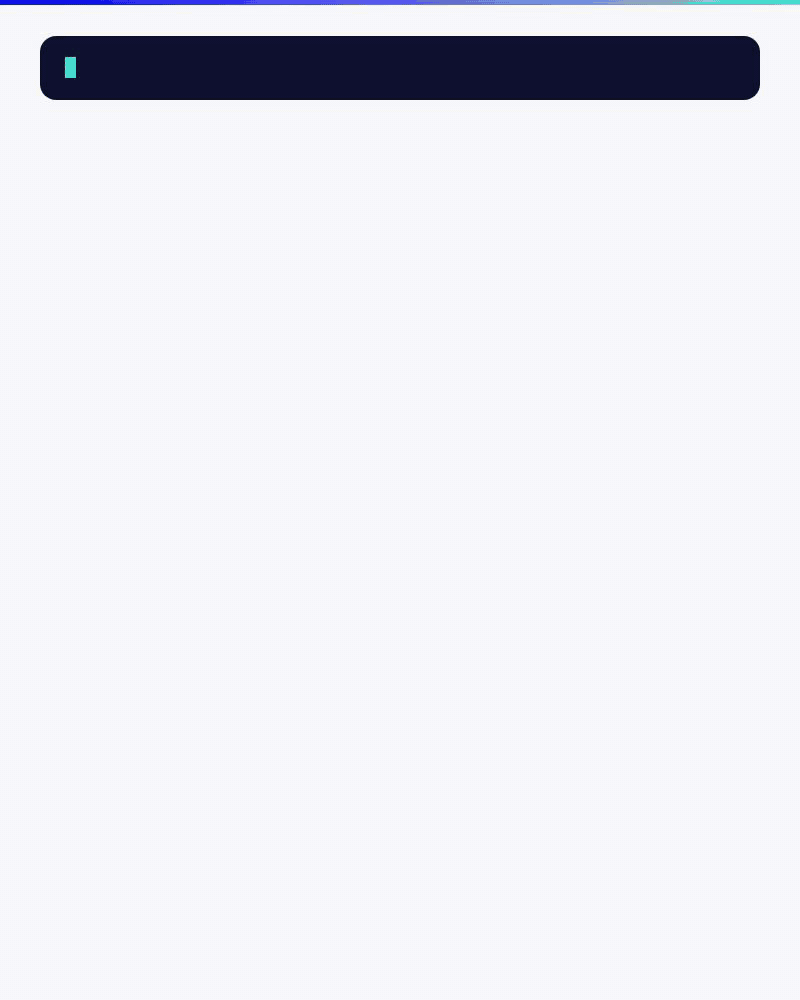

# Conferbot Android SDK

[](https://jitpack.io/#Conferbot/conferbot-android)
[-green.svg)](https://developer.android.com)
[](https://kotlinlang.org)
[](LICENSE)

Add your [Conferbot](https://conferbot.com) chatbot to a native Android app. The chat looks and behaves like the Conferbot web widget: your dashboard settings, the bot's flows, the AI agent, handover to your team, the help centre and "Your requests". It works with Jetpack Compose and with XML Views, or you can build your own UI on the SDK's state.

## Quickstart video

<!-- TODO(video): replace VIDEO_ID with the walkthrough's YouTube id and add docs/media/quickstart.gif (a short clip of it). -->
<p align="center">
  <a href="https://youtu.be/VIDEO_ID">
    
  </a>
</p>

<p align="center"><a href="https://youtu.be/VIDEO_ID">Watch the full walkthrough on YouTube</a></p>

<p align="center">
  
  
  
</p>

**Contents:** [Requirements](#requirements) · [Install](#install) · [Get your bot ID](#get-your-bot-id) · [Add the chat](#add-the-chat) · [Sign users in](#sign-users-in) · [Push notifications](#push-notifications) · [Customising](#customising) · [Help centre and Your requests](#help-centre-and-your-requests) · [API reference](#api-reference) · [Troubleshooting](#troubleshooting) · [Contributing and testing](#contributing-and-testing)

## Requirements

| | Minimum | Notes |
|---|---|---|
| Android | 5.0 (API 21) | `minSdk 21` |
| Compile SDK | 34 | the SDK's AndroidX dependencies need `compileSdk 34` |
| Kotlin | 1.9 | the SDK is built with Kotlin 1.9.0 |
| JDK | 17 | the SDK targets JVM 17; Android Gradle Plugin 8.x |
| Jetpack Compose | optional | the SDK brings its own Compose libraries (BOM 2023.10.01). An XML app needs no Compose setup; a Compose app needs Compose 1.5 or newer |
| Firebase | optional | only for push notifications, see [Push notifications](#push-notifications) |

Permissions: the SDK's manifest adds `INTERNET`, `ACCESS_NETWORK_STATE`, `POST_NOTIFICATIONS`, `VIBRATE`, `WAKE_LOCK` and `FOREGROUND_SERVICE`; you do not need to declare them.

## Install

The SDK is published on [JitPack](https://jitpack.io/#Conferbot/conferbot-android) as `com.github.Conferbot:conferbot-android`.

**1. Add the JitPack repository** in `settings.gradle`:

```gradle
dependencyResolutionManagement {
    repositories {
        google()
        mavenCentral()
        maven { url 'https://jitpack.io' }
    }
}
```

Kotlin DSL (`settings.gradle.kts`):

```kotlin
dependencyResolutionManagement {
    repositories {
        google()
        mavenCentral()
        maven { url = uri("https://jitpack.io") }
    }
}
```

**2. Add the dependency** in your app module's `build.gradle`:

```gradle
dependencies {
    implementation 'com.github.Conferbot:conferbot-android:2.0.0'
}
```

```kotlin
dependencies {
    implementation("com.github.Conferbot:conferbot-android:2.0.0")
}
```

> This guide describes version 2.0.0 (see [CHANGELOG.md](CHANGELOG.md)). To try unreleased changes on `main`, use `main-SNAPSHOT` or a commit hash as the version.

To build against a local checkout instead, add `include(":conferbot")` with `project(":conferbot").projectDir = file("path/to/conferbot-android/conferbot")` to `settings.gradle` and depend on `project(":conferbot")`.

**Minified builds:** the SDK ships its own consumer ProGuard / R8 rules. Nothing to add.

## Get your bot ID

1. Sign in to the [Conferbot dashboard](https://app.conferbot.com) and open your bot.
2. Go to the **Share** tab. Under **Mobile apps**, pick **Android**: the snippet there has your bot ID filled in. (The bot ID is the 24-character id of the bot; in the inbox, a bot's menu also has **Copy chatbot ID**.)
3. **Publish** the bot in the flow builder. Draft flows are not served to the SDK.

The `apiKey` argument is a placeholder for now: any non-empty value works (the dashboard's snippet uses `conf_test_key`). The bot ID is what identifies your bot.

Just trying it out? The public demo bot `691c970890527a0468f9b2c9` works without an account.

## Add the chat

### 1. Initialize once, in your `Application`

```kotlin
import android.app.Application
import com.conferbot.sdk.core.Conferbot

class MyApplication : Application() {
    override fun onCreate() {
        super.onCreate()
        Conferbot.initialize(
            context = this,
            apiKey = "conf_test_key",
            botId = "YOUR_BOT_ID"
        )
    }
}
```

Register it in `AndroidManifest.xml`:

```xml
<application
    android:name=".MyApplication"
    ...>
</application>
```

`initialize()` throws `IllegalStateException` when it is called twice. To switch bots, call `Conferbot.disconnect()` first.

### 2a. Jetpack Compose

The floating launcher, as on the web: a button in the corner, the greeting card, the unread badge, and the chat in a sheet. Its shape, colour, icon, position and greeting come from your dashboard.

```kotlin
import androidx.compose.runtime.Composable
import com.conferbot.sdk.ui.compose.ConferBotWidgetScope

@Composable
fun MyApp() {
    ConferBotWidgetScope {
        MyMainScreen() // your content; the launcher floats over it
    }
}
```

Or place `ConferBotWidget()` yourself, last in a `Box` that fills the screen.

A full-screen chat that you open yourself:

```kotlin
import androidx.compose.material3.Button
import androidx.compose.material3.Text
import androidx.compose.runtime.*
import com.conferbot.sdk.ui.compose.ConferBotChatScreen

@Composable
fun SupportScreen() {
    var showChat by remember { mutableStateOf(false) }
    if (showChat) {
        ConferBotChatScreen(onDismiss = { showChat = false })
    } else {
        Button(onClick = { showChat = true }) { Text("Chat with us") }
    }
}
```

### 2b. XML Views

One call opens the full-screen chat (`ChatActivity`):

```kotlin
import android.os.Bundle
import androidx.appcompat.app.AppCompatActivity
import com.conferbot.sdk.core.Conferbot

class MainActivity : AppCompatActivity() {
    override fun onCreate(savedInstanceState: Bundle?) {
        super.onCreate(savedInstanceState)
        setContentView(R.layout.activity_main)
        findViewById<android.view.View>(R.id.chat_button).setOnClickListener {
            Conferbot.openChat(this)
        }
    }
}
```

`ChatActivity` hosts the same chat as Compose, so an XML app gets every feature: the home screen, help centre, "Your requests", the wait cards and games, step cards and the post-chat redirect. Your app needs no Compose setup for it. There is no XML version of the floating launcher; use your own button or `FloatingActionButton` with `openChat`.

`ConferBotCustomization` passed to `initialize()` themes the chat until the bot's own settings arrive (see [Customising](#customising)).

### 2c. Your own UI (headless)

Every piece of state is a `StateFlow` on `Conferbot`:

```kotlin
val messages by Conferbot.record.collectAsState()        // List<RecordItem>
val connected by Conferbot.isConnected.collectAsState()
val agent by Conferbot.currentAgent.collectAsState()       // Agent? while a person is in the chat

Conferbot.sendMessage("Hello from my custom UI")
Conferbot.initiateHandover(message = "I need help with billing")
Conferbot.endChat()
```

A waiting flow step is `Conferbot.currentUIState.value?.step`; answer it with `Conferbot.answerStep(FlowStepAnswer.consent(true))` and the other builders in `com.conferbot.sdk.core.flow.FlowStepAnswer`.

### Resume the last conversation

Chat history is kept on the device (Room). To pick a conversation up after the app restarts, restore it before opening the chat:

```kotlin
lifecycleScope.launch {
    if (Conferbot.hasPersistedSession()) Conferbot.restorePersistedSession()
    Conferbot.openChat(this@MainActivity)
}
```

A live chat comes back live with its agent; a chat still in the queue waits again. `Conferbot.clearHistory()` forgets the conversation.

### What the chat does

You do not need code for any of this; it follows the bot and the dashboard.

- **Flows** run as on the web: every step type the flow builder offers, with cards for consent, OTP, address, signature, matrix, ranking, slider, date and time, calendar, payment (Stripe Checkout in the browser), carousel and product cards. GPT, AI and knowledge-base steps run on Conferbot's server; the app holds no AI key.
- **Handover to your team:** "Connecting you with the team…", the wait card with the estimate and the step's max wait, **Cancel** to leave the queue, help articles and games while the visitor waits, "Connected with the team" and the agent's replies live, the post-chat rating and **Start a new chat** when it ends.
- **AI agent:** formatted answers, cited help articles, **Helpful?** with reasons, "Talk to a person" when allowed, the "took too long" notice after 45 seconds.
- **Home screen** (when the owner turns it on): greeting, "Ask anything", "Talk to us" with the team's reply time, recent help articles.
- **Chat menu:** Email me this chat, Sound on / off, Your requests.
- **Offline:** messages are queued while the phone is offline and sent when it is back (`enableOfflineMode`, on by default).

## Sign users in

When your app knows who the user is, tell the SDK before the chat opens. The dashboard then shows their name, email and your own fields, and "Your requests" lists their conversations.

```kotlin
import com.conferbot.sdk.models.ConferBotUser

Conferbot.identify(
    ConferBotUser(
        id = "user-123",
        name = "Jane Doe",
        email = "jane@example.com",
        phone = "+1234567890",
        metadata = mapOf("plan" to "premium", "company" to "Acme"),
        hash = hashFromYourServer // see below
    )
)
```

You can also pass `user = ConferBotUser(...)` to `initialize()`. The user id is attached when the conversation is created, so identify **before** the chat is opened. `name` and `metadata` also fill the owner's "greet by name" placeholders such as `Hi {{first_name|there}}`.

### Identity verification (the `hash`)

Without verification, anyone could put any id or email in the app and be filed as that person. To stop that, turn on **Identity verification** in your workspace settings (**Security**) and send a `hash` with the user: the HMAC-SHA256, in hex, of the user's `id` (or their email when there is no id), keyed with your workspace's identity secret.

Make the hash **on your server** and send it to the app with the signed-in user. Never put the secret in the app.

```js
// Node.js, on your server
const crypto = require("crypto");

function conferbotUserHash(user) {
  const signed = String(user.id || user.email).trim();
  return crypto
    .createHmac("sha256", process.env.CONFERBOT_IDENTITY_SECRET)
    .update(signed)
    .digest("hex");
}

// e.g. in your login or /me response:
// res.json({ ...user, conferbotHash: conferbotUserHash(user) })
```

Conferbot checks the hash on every message and never stores it. A matching hash files the chat as verified. When the workspace **requires** verification, a missing or wrong hash drops the claimed name, email and id, so the chat is an anonymous visitor's; otherwise it is kept as unverified.

### Sign out

```kotlin
Conferbot.identify(null) // on the main thread
```

On a shared device the next person sees nothing of the last one's: their "Your requests" list and draft replies go at once, an answer still on its way for them is ignored, the greeting forgets their name, and the device's push token is unregistered from their conversation. Signing a different user in works the same way. `Conferbot.clearHistory()` also forgets the conversation on the device.

## Push notifications

When an agent or the AI replies while the visitor is not in the chat, Conferbot can send a push. Firebase is **optional**: the SDK only compiles against `firebase-messaging` and declares no service, so nothing happens until your app adds Firebase and hands the SDK a token.

**1. Add Firebase Cloud Messaging to your app:** `google-services.json`, the `com.google.gms.google-services` plugin, and

```gradle
implementation platform('com.google.firebase:firebase-bom:32.7.0')
implementation 'com.google.firebase:firebase-messaging-ktx'
```

**2. Give the SDK the token.** It is registered with the current conversation and again for each new one.

```kotlin
import com.conferbot.sdk.notifications.PushTokenType
import com.google.firebase.messaging.FirebaseMessaging

FirebaseMessaging.getInstance().token.addOnSuccessListener { token ->
    Conferbot.setPushToken(token, PushTokenType.FCM)
}
```

**3. Receive messages.** If Conferbot is your app's only FCM sender, declare the SDK's service in your `AndroidManifest.xml`:

```xml
<service
    android:name="com.conferbot.sdk.notifications.ConferbotNotificationService"
    android:exported="false">
    <intent-filter>
        <action android:name="com.google.firebase.MESSAGING_EVENT" />
    </intent-filter>
</service>
```

If you already have a `FirebaseMessagingService` (Android delivers to only one), forward to the SDK instead:

```kotlin
import com.conferbot.sdk.core.Conferbot
import com.conferbot.sdk.notifications.PushTokenType
import com.google.firebase.messaging.FirebaseMessagingService
import com.google.firebase.messaging.RemoteMessage

class MyMessagingService : FirebaseMessagingService() {
    override fun onNewToken(token: String) {
        Conferbot.setPushToken(token, PushTokenType.FCM)
    }

    override fun onMessageReceived(message: RemoteMessage) {
        // In the foreground: counted unread and shown, unless that conversation is on screen.
        if (Conferbot.handlePushNotification(message.data, open = false)) return
        // ...your own notifications
    }
}
```

`handlePushNotification` returns `true` only for a Conferbot push of this bot, so your other notifications are untouched.

**4. Open taps.** In the background Android shows the notification itself, and a tap starts your launcher activity with the push's data as extras:

```kotlin
override fun onCreate(savedInstanceState: Bundle?) {
    super.onCreate(savedInstanceState)
    Conferbot.handlePushIntent(intent)
}

override fun onNewIntent(intent: Intent) {
    super.onNewIntent(intent)
    Conferbot.handlePushIntent(intent)
}
```

The tap opens the chat on that conversation (or the conversation in "Your requests" when it is not the one on the device). A tap that arrives before `initialize()` is opened once the SDK is ready.

**Good to know**

- Notifications use the `conferbot_messages` channel, which the SDK creates when `enableNotifications` is on (the default). One notification per conversation. Set your own small icon with the `com.google.firebase.messaging.default_notification_icon` meta-data.
- On Android 13+ ask for `POST_NOTIFICATIONS` at a moment that suits your app.
- `setPushToken(null)` or `unregisterPush()` stops this device's pushes. `registerPushToken()` / `unregisterPushToken()` from 1.0.0 still work but are deprecated.
- **Server side:** sending is off until Conferbot's embed-server runs with `MOBILE_PUSH_ENABLED=true` and FCM credentials (embed-server `docs/mobile-push.md`). The credentials are platform-wide for now, so pushes reach only apps on Conferbot's own Firebase project. Per-workspace credentials for your own Firebase project are not built yet (embed-server #197): until then your app's tokens register, but FCM refuses its pushes (`SENDER_ID_MISMATCH`).

## Customising

### Dashboard first, code as a fallback

Almost everything is set in the dashboard (**Customize**) and applied with no code: theme (27 themes, light / dark / auto), colours, chat background, bot name and avatar, bubble and option corners, the launcher's shape, icon, motion and greeting card, the mascot, the home screen, sounds, font, language and the post-chat redirect. The server's values always win.

Code is for defaults until the bot's settings arrive, and for what only the app knows:

```kotlin
import com.conferbot.sdk.models.ConferBotConfig
import com.conferbot.sdk.models.ConferBotCustomization

Conferbot.initialize(
    context = this,
    apiKey = "conf_test_key",
    botId = "YOUR_BOT_ID",
    config = ConferBotConfig(
        enableNotifications = true,   // the notification channel and in-app notifications
        enableOfflineMode = true,     // queue messages while offline
        widgetLanguage = null         // see Languages
    ),
    customization = ConferBotCustomization(
        primaryColor = ConferBotCustomization.parseColor("#0808EE"),
        botBubbleColor = ConferBotCustomization.parseColor("#F3F4F6"),
        userBubbleColor = ConferBotCustomization.parseColor("#0808EE"),
        bubbleRadius = 16f,
        headerTitle = "Support"
    )
)
```

In Compose you can also give the chat a local theme, used when the bot has no customizations of its own:

```kotlin
import androidx.compose.ui.graphics.Color
import androidx.compose.ui.unit.dp
import com.conferbot.sdk.ui.compose.ConferBotChatView
import com.conferbot.sdk.ui.theme.ConferbotThemeBuilder

val brand = ConferbotThemeBuilder.create()
    .primaryColor(Color(0xFF0808EE))
    .headerColors(background = Color(0xFF0808EE), text = Color.White)
    .bubbleRadius(16.dp)
    .build()

ConferBotChatView(lightTheme = brand)
```

The floating launcher takes fallbacks too: `ConferBotWidget(config = ConferBotWidgetConfig(position = WidgetPosition.BOTTOM_LEFT, size = 56.dp))`.

### Languages

The SDK's own words (buttons, hints, errors, handover lines, the help centre, dates and "5 min ago") are in English, Dutch, French, German or Spanish, with the web widget's wording. The language is, in order:

1. `ConferBotConfig.widgetLanguage` when the app sets it: `"en"`, `"nl"`, `"fr"`, `"de"`, `"es"` or `"auto"`;
2. the language the owner picked in the dashboard;
3. for "auto" (and every bot that never chose), the first of the phone's languages the widget speaks;
4. English.

What the owner wrote (greetings, questions, buttons, articles) is shown as written. `Conferbot.widgetLanguage` says which language is in force.

### Fonts

The owner's font (any of the dashboard's Google fonts) is fetched once, cached on the device and used for all the chat's text. A system font the owner picked (Georgia, Verdana...) is asked of the device by name, so a family your app bundles under that name is picked up. Until it loads, or when it cannot, the chat uses `ConferBotCustomization.fontFamily` (a font resource id) or the platform font. In Compose, `ConferbotThemeBuilder.fontFamily(...)` sets the local theme's font.

### Sounds

The owner's message sound and sound pack (open, message, send, close) play at the media volume, at most one message sound every 0.8 s. The chat menu has **Sound on / off**; the choice is kept on the device. From code: `Conferbot.sounds.soundOn` (a `StateFlow<Boolean>`) and `Conferbot.sounds.toggle()`.

### Redirect after the chat

When the owner sets a post-chat redirect URL, the chat shows "Taking you to example.com in 10s" with **Cancel** once the conversation ends (after the rating, if there is one), then opens the URL in the system browser. Only `http(s)` URLs are followed, and only once per conversation. To open it your own way, or to turn it off:

```kotlin
ConferBotConfig(
    onPostChatRedirect = { url -> openInMyWebView(url); true }, // true: handled, no countdown
    // disablePostChatRedirect = true
)
```

### Hooks

Events from the chat, all with default no-op implementations:

```kotlin
import com.conferbot.sdk.core.ConferBotEventListener
import com.conferbot.sdk.models.Agent
import com.conferbot.sdk.models.RecordItem

Conferbot.setEventListener(object : ConferBotEventListener {
    override fun onSessionStarted(sessionId: String) { }
    override fun onMessageReceived(message: RecordItem) { }
    override fun onAgentJoined(agent: Agent) { }
    override fun onUnreadCountChanged(count: Int) { }
})
```

The web widget's handover signals (`cb:waiting-for-human`, `cb:human-joined`, `cb:wait-over`):

```kotlin
import com.conferbot.sdk.core.livechat.HandoverSignals
import com.conferbot.sdk.core.livechat.WidgetSignal

val stop = Conferbot.onWidgetSignal(HandoverSignals.WAIT_OVER_EVENT) { signal ->
    val reason = (signal as WidgetSignal.WaitOver).reason // unavailable, cancelled or ended
}
stop() // stop listening
```

Analytics: `Conferbot.setUtmParameters(utmSource = "newsletter")`, `trackInteraction(...)`, `trackGoalCompletion("goal-id", conversionValue = 49.0)`. Raw socket events: `Conferbot.on(SocketEvents.BOT_RESPONSE, listener)` / `off(...)` take an `io.socket.emitter.Emitter.Listener`; add `implementation 'io.socket:socket.io-client:2.1.0'` to your app to use them (the SDK does not expose Socket.IO to your compile classpath).

Endpoints: the SDK talks to `https://wdt.conferbot.com`. To go through your own proxy, pass `baseUrl` (ending in `/api/v1/mobile/`) and `socketUrl` to `initialize()`, or call `ConferBotEndpoints.setApiBaseUrl(...)` / `setSocketUrl(...)` (HTTPS only) before it.

## Help centre and Your requests

### Help centre

The help centre follows the bot's settings: it shows while **Help articles** is on in the dashboard and at least one article is published. The chat then has a **Chat / Articles** switch (or, with a home screen, its own view). AI answers that cite an article open it in the app.

From your own screens:

```kotlin
if (Conferbot.isHelpCentreOn) {
    Conferbot.openHelpArticle(articleId = "ARTICLE_ID")  // in the chat's help centre
}
```

Or show it on a Compose screen of its own:

```kotlin
import com.conferbot.sdk.ui.compose.knowledgebase.KnowledgeBaseScreen

val kb = Conferbot.initKnowledgeBaseService()
if (kb != null && Conferbot.isHelpCentreOn) {
    KnowledgeBaseScreen(knowledgeBaseService = kb, onDismiss = { /* close */ })
}
```

Headless: `Conferbot.knowledgeBase` (a `StateFlow`), `searchKnowledgeBase(query)`, `rateKnowledgeBaseArticle(articleId, helpful)`.

### Your requests

Visitors follow their conversations with your team and answer them, as on the web widget's home screen: the chat menu has **Your requests** once they have one (**New reply** when a team reply is unread). Only the visitor's own conversations are listed: chats this device started, or every verified conversation of a signed-in user whose `hash` is valid.

Your own entry point with a badge:

```kotlin
lifecycleScope.launch {
    Conferbot.requestsUnread.collect { unread -> badge.isVisible = unread > 0 }
}

Conferbot.openRequests()            // the list
Conferbot.openRequests(requestId)   // one request
```

`openRequests()` opens over the chat (Compose and `ChatActivity`); to open it over your own Compose screen, place `RequestsPortalView()` there.

## API reference

All members are on `com.conferbot.sdk.core.Conferbot` unless noted.

### Setup and chat

| Member | Description |
|---|---|
| `initialize(context, apiKey, botId, config = ConferBotConfig(), customization: ConferBotCustomization? = null, user: ConferBotUser? = null, baseUrl: String? = null, socketUrl: String? = null, paginationConfig = PaginationConfig())` | Set up once; throws when already initialized |
| `openChat(context)` | Open the full-screen chat (`ChatActivity`) |
| `disconnect()` | Tear everything down; `initialize()` may be called again |
| `identify(user: ConferBotUser?)` | Sign a user in; `null` signs out |
| `sendMessage(text)` / `sendTypingStatus(isTyping)` | Send as the visitor |
| `answerStep(response)` | Answer the waiting flow step (`FlowStepAnswer`) |
| `initiateHandover(message: String? = null)` | Ask for a person |
| `leaveQueue(onDone: (Boolean) -> Unit = {})` | Leave the queue; `false` when a person already has the chat |
| `endChat()` / `startNewChat()` | End the conversation / start a fresh one after it closed |
| `sendAnswerFeedback(agentMessageId, feedback: AnswerFeedback)` | A vote on an AI answer |
| `liveChat.openEmailTranscript()` | Show the "Email me this chat" card |
| `showHome()` / `showChat(text: String? = null)` / `showHelp(categoryId: String? = null)` | Switch the chat's view |
| `hasPersistedSession()` / `restorePersistedSession()` | `suspend`: resume the last conversation |
| `clearHistory()` | Forget the conversation on the device |
| `loadMoreMessages()` / `hasMoreMessages()` | History paging for a custom UI |
| `setEventListener(listener)` | `ConferBotEventListener` callbacks |
| `onWidgetSignal(name, listener): () -> Unit` | Handover signals; returns the unsubscribe |
| `on(event, listener)` / `off(event, listener)` | Raw socket events (`SocketEvents`) |

### Push

| Member | Description |
|---|---|
| `setPushToken(token: String?, type: PushTokenType? = null)` | Register the device's token with each conversation; `null` unregisters |
| `unregisterPush()` | Stop this device's pushes |
| `handlePushNotification(data: Map<String, String>, open: Boolean = true): Boolean` | Handle a Conferbot push; `false` for anything else |
| `handlePushIntent(intent: Intent?): Boolean` | Handle a tapped push's launcher intent |
| `setNotificationChatActivity(activityClass)` | The Activity a notification tap opens (default `ChatActivity`) |
| `updateNotificationSettings(settings)` / `addNotificationListener(listener)` / `cancelAllNotifications()` | In-app notification behaviour |
| `registerPushToken(token)` / `unregisterPushToken()` | Deprecated: `setPushToken` / `unregisterPush` |
| `ConferbotNotificationService` | `com.conferbot.sdk.notifications`: the FCM service to declare (open, so you can extend it) |

### Help centre and requests

| Member | Description |
|---|---|
| `isHelpCentreOn: Boolean` | Help articles on, with published articles |
| `openHelpArticle(articleId, title: String? = null, fromChat: Boolean = true): Boolean` | Open an article in the chat's help centre |
| `initKnowledgeBaseService(): KnowledgeBaseService?` | The service `KnowledgeBaseScreen` takes |
| `knowledgeBase: StateFlow<KnowledgeBaseData?>` | Categories and articles |
| `searchKnowledgeBase(query)` / `rateKnowledgeBaseArticle(articleId, helpful)` | Search and rate |
| `requests.requests: StateFlow<List<RequestSummary>?>` | The visitor's requests (null until read) |
| `requestsUnread: StateFlow<Int>` | Requests with an unread team reply |
| `openRequests(requestId: String? = null)` | Open the list, or one request |

### State

| Property | Type |
|---|---|
| `isInitialized`, `isConnected`, `isOnline` | `StateFlow<Boolean>` |
| `chatSessionId` | `StateFlow<String?>` |
| `record` | `StateFlow<List<RecordItem>>` (the conversation) |
| `currentAgent` | `StateFlow<Agent?>` |
| `isAgentTyping`, `isLiveChatMode`, `isChatVisible` | `StateFlow<Boolean>` |
| `unreadCount`, `pendingMessageCount` | `StateFlow<Int>` |
| `currentUIState` | `StateFlow<NodeUIState?>` (the waiting step) |
| `homeView` | `StateFlow<HomeView>` (`HOME`, `CHAT`, `HELP`) |
| `serverCustomization` / `serverTheme` | the dashboard's settings / the theme built from them |
| `widgetLanguage` | `String`, the language in force |

### Configuration

| `ConferBotConfig` | Default | Description |
|---|---|---|
| `enableNotifications` | `true` | The `conferbot_messages` channel and in-app notifications |
| `enableOfflineMode` | `true` | Queue messages while offline |
| `autoConnect` | `true` | Connect on `initialize()` |
| `reconnectionAttempts` / `reconnectionDelay` | `null` (5 / 1000 ms) | Socket reconnection |
| `widgetLanguage` | `null` | `"en"`, `"nl"`, `"fr"`, `"de"`, `"es"` or `"auto"`; wins over the owner's |
| `onPostChatRedirect` | `null` | `(url) -> Boolean`; `true` when the app handled the URL |
| `disablePostChatRedirect` | `false` | Never follow the post-chat redirect |

| `ConferBotUser` | Description |
|---|---|
| `id` | Your user id (required) |
| `name`, `email`, `phone` | Shown in the dashboard |
| `metadata: Map<String, Any>?` | Your own fields; also `{{first_name}}`, `{{company}}` placeholders |
| `hash` | Identity verification HMAC, made on your server |

### UI

| Composable / class | Description |
|---|---|
| `ConferBotWidget(config = ConferBotWidgetConfig(), modifier)` | The floating launcher with its chat sheet |
| `ConferBotWidgetScope(config, content)` | Your content with the launcher over it |
| `ConferBotChatScreen(onDismiss = {}, modifier)` | The full chat, themed by the dashboard |
| `ConferBotChatView(modifier, lightTheme, darkTheme, useDarkTheme)` | The chat with a local theme as fallback |
| `KnowledgeBaseScreen(knowledgeBaseService, onDismiss, ...)` | The help centre on its own |
| `HomeScreenView(onClose)` | The home screen (`com.conferbot.sdk.ui.compose.home`) |
| `RequestsPortalView()` | Where `openRequests()` opens over your own screen |
| `ChatActivity` | `com.conferbot.sdk.ui.views`: the full-screen chat for XML apps |

More: [docs/USAGE.md](docs/USAGE.md), [docs/API.md](docs/API.md), [docs/ARCHITECTURE.md](docs/ARCHITECTURE.md), [docs/EXAMPLES.md](docs/EXAMPLES.md).

## Troubleshooting

**The chat stays empty.**
1. Publish the bot; drafts are not served.
2. Check the bot ID (24 characters, from the Share tab). A wrong id gives an empty chat.
3. The phone needs HTTPS and WebSocket access to `wdt.conferbot.com`. Corporate proxies that block WebSockets stop messages.
4. Try the demo bot `691c970890527a0468f9b2c9`. If it loads, the problem is your bot's id or publish state.
5. Filter Logcat by `Conferbot`.

**`IllegalStateException: Conferbot SDK is already initialized`.** Initialize once, in `Application.onCreate()`. Call `disconnect()` before initializing again.

**My XML layout or colour overrides no longer change the chat.** Since the XML chat hosts the Compose chat it no longer inflates `activity_chat.xml` and friends. Use `ConferBotCustomization`, the dashboard, or your own Activity with `ConferBotChatView`. See [CHANGELOG.md](CHANGELOG.md).

**No push notifications.**
- Firebase is not bundled any more: add `firebase-messaging` and declare `ConferbotNotificationService` (or forward from your service).
- Check that `setPushToken` is called and, on Android 13+, that the app may post notifications.
- Sending is off on the server until push is enabled, and for now reaches only apps on Conferbot's Firebase project (see [Push notifications](#push-notifications)).

**`ClassNotFoundException: com.google.firebase...`.** You declared `ConferbotNotificationService` without adding `firebase-messaging` to the app.

**The identity hash is rejected.** Hash exactly the `id` you pass (or the email when there is no id), trimmed, with the workspace's current secret, as hex.

**A different language than expected.** `ConferBotConfig.widgetLanguage` wins over the dashboard; "auto" follows the phone's language list.

## Contributing and testing

- Build: `sh ./gradlew :conferbot:assembleDebug`
- Unit tests: `sh ./gradlew :conferbot:testDebugUnitTest --no-daemon -q` (results in `conferbot/build/test-results/`)
- The example app: [example/README.md](example/README.md), against Conferbot's cloud or a local server.
- [docs/PARITY.md](docs/PARITY.md) tracks every web-widget feature in this SDK, with its issue, files and tests, and how to test on a device.
- Changes are listed in [CHANGELOG.md](CHANGELOG.md).

Bug reports and feature requests: [GitHub Issues](https://github.com/Conferbot/conferbot-android/issues). Please open an issue before a large pull request.

## License

Apache 2.0, see [LICENSE](LICENSE).
